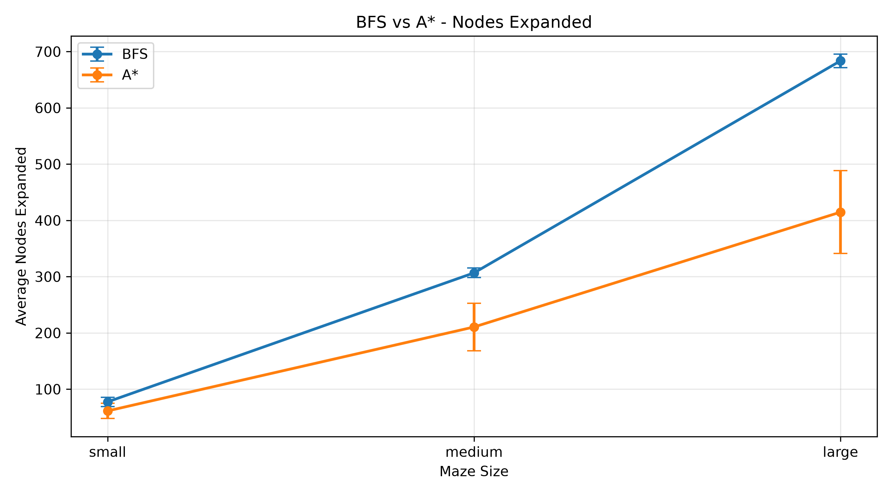
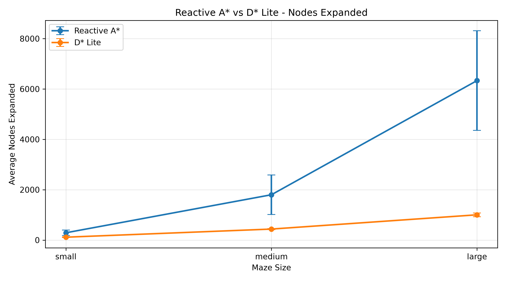

# Maze Algorithm Experiment Results

## Overview

This folder contains the output of the maze-solving algorithm experiments. The current experiment compares Breadth-First Search (BFS), Depth-First Search (DFS), A*, and Reactive A* on small, medium, and large mazes.

## Output File

`maze_results.csv` contains one record for each algorithm run.

### Column Definitions

| Column | Meaning | Unit or Format |
|---|---|---|
| `maze_id` | Identifier of the input maze | Text |
| `algorithm` | Algorithm used: BFS, DFS, A*, or Reactive A* | Text |
| `path_length` | Number of steps in the returned path, as reported by the solver | Steps |
| `nodes_expanded` | Number of nodes expanded by the solver | Nodes |
| `runtime_seconds` | Measured execution time | Seconds |
| `peak_memory_kb` | Peak Python memory traced during the algorithm run using `tracemalloc` | KB (1024 bytes) |
| `replan_count` | Number of replanning events recorded by the program | Count |
| `obstacles_discovered` | Number of previously unknown obstacles discovered by Reactive A* | Count |
| `actual_distance` | Actual distance travelled by the robot | Steps |
| `plan_count` | Total number of path-planning operations performed | Count |
| `path_found` | Whether the solver successfully reached the goal | Boolean (`True`/`False`) |

## How to Reproduce

Run these commands from the repository root in a Python environment with the required dependencies installed:

```powershell
python -m src.main
```

If using the project's virtual environment on Windows:

```powershell
.\.venv\Scripts\python.exe -m src.main
```

The program reads maze JSON files from `data/raw/`, runs BFS, DFS, A*, and Reactive A* on each maze, and writes the results to `results/maze_results.csv`.

The output file is overwritten each time the command runs.

## Experimental Setup

- Input mazes: JSON files stored in `data/raw/`.
- Maze groups: small, medium, and large.
- Seeds represented in the current dataset: 42, 43, and 44.
- Algorithms: BFS, DFS, A*, and Reactive A*.
- Metrics: path length, nodes expanded, runtime, peak traced Python memory, replanning count, obstacles discovered, and actual distance.
- Current dataset: 9 maze files and 36 algorithm result records.

## Measurement Assumptions and Limitations

- Runtime is measured using Python's `time.perf_counter()`. It may vary between runs because of machine load and other execution conditions.
- Memory is measured using `tracemalloc`. It represents traced Python memory, not total process memory or total computer RAM.
- BFS, DFS, and A* use complete maze information and do not perform online replanning.
- Reactive A* initially plans using incomplete maze information and replans when it encounters an unknown obstacle.
- Unknown cells are treated as traversable during initial planning until an obstacle is discovered.
- Results describe the current implementation and input mazes. They should not be treated as universal performance guarantees.
- The experiment log in the repository root, `experiments.csv`, records selected experiment runs and their main metrics.

## Week 5 – Member 3 Algorithm Output Format

The file `member3_algorithm_output.csv` defines the output format for Member 3's Wall Following algorithm experiments.

It contains five illustrative dummy records. These values are examples only, not actual experimental measurements.

The columns record:
- Run and maze identifiers
- Algorithm and start/goal coordinates
- Path found and path length
- Nodes expanded, runtime and peak memory
- Obstacles discovered and replanning count
- Actual distance and navigation success

Actual experimental measurements will replace dummy values after testing.

## Week 5 — Sample Output Format

`sample_output.csv` is a dummy file created to demonstrate the agreed output columns. Its values are illustrative only and are not actual experiment results.

Columns:
- `maze_id`: identifier for the maze
- `algorithm`: algorithm used
- `path_length`: number of steps in the path
- `nodes_expanded`: number of nodes explored
- `runtime_seconds`: execution time in seconds
- `peak_memory_kb`: measured peak memory in KB
- `replan_count`: number of replanning events
- `path_found`: whether a path was found

## Week 5 – Member 2 Navigation Output Format

The file `member2_navigation_output.csv` defines the output format for Member 2's Autonomous Navigation and Replanning experiments.

The file contains five illustrative dummy records. These values demonstrate the agreed structure and are not actual experimental measurements.

### Output Columns

- `run_id`: Unique experiment run identifier.
- `maze_id`: Identifier of the maze being tested.
- `algorithm`: Navigation algorithm used.
- `start_x`, `start_y`: Starting coordinates of the robot.
- `goal_x`, `goal_y`: Goal coordinates.
- `path_found`: Indicates whether a valid path was found.
- `path_length`: Length of the planned path.
- `nodes_expanded`: Number of nodes explored during path planning.
- `runtime_seconds`: Execution time in seconds.
- `peak_memory_kb`: Peak memory usage in KB.
- `obstacles_discovered`: Number of previously unknown obstacles discovered.
- `replan_count`: Number of replanning operations.
- `actual_distance`: Actual distance travelled by the robot.
- `navigation_success`: Indicates whether the robot successfully reached its goal.

The dummy records remain illustrative. Actual Week 6 navigation measurements are recorded in `maze_results.csv`.

## Week 6 – Member 2 Reactive A* Implementation and Results

Reactive A* was integrated into the main maze-solving program and tested end-to-end on all nine maze files.

Unlike the standard A* algorithm, which has complete maze information, Reactive A* initially plans using partial information. When the robot encounters an unknown obstacle, it records the obstacle and calculates a new path.

### Implementation Features

- Initial path planning using A*.
- Navigation using partially known maze information.
- Discovery of previously unknown obstacles.
- Automatic replanning when an obstacle blocks the planned path.
- Tracking of replanning operations and discovered obstacles.
- Measurement of execution time and peak memory usage.

### Experimental Results

Reactive A* successfully reached the goal in all nine test mazes.

| Maze Group | Number of Mazes | Successful Runs | Reactive A* Actual Distance |
|---|---:|---:|---|
| Small | 3 | 3/3 | 32, 20, 34 |
| Medium | 3 | 3/3 | 44, 54, 72 |
| Large | 3 | 3/3 | 82, 76, 94 |
| **Total** | **9** | **9/9** | **Average: 56.44 steps** |

### Comparison with BFS Baseline

The Week 4 BFS baseline recorded an average of 356.11 expanded nodes across nine mazes.

The Week 6 Reactive A* experiment recorded an average of 2,921.56 expanded nodes across the same nine-maze dataset.

Reactive A* expanded more nodes because it repeatedly performs path planning as new obstacles are discovered. Unlike BFS and standard A*, it operates with incomplete information and must adapt its route during navigation.

### Additional Measurements

- Navigation success rate: 100%.
- Average replanning count: 15.11.
- Average nodes expanded: 2,921.56.
- Average runtime: approximately 0.007978 seconds.
- Average peak memory: approximately 55.11 KB.
- Average actual distance travelled: 56.44 steps.

### Conclusion

The Week 6 experiment demonstrates that Reactive A* can successfully navigate all nine tested mazes while discovering obstacles and replanning routes dynamically.

The results show the trade-off between complete-information path planning and navigation under partial information. Reactive A* successfully adapts to newly discovered obstacles, although its repeated planning increases computational work compared with algorithms that know the complete maze in advance.

The experiment results are saved in `maze_results.csv`, and the selected experiment summary is recorded as Run 005 in `experiments.csv`.
## Member 1 - Multi-Algorithm Experiment Evaluation

### Objective

This experiment evaluates five maze-solving algorithms across three maze sizes using ten different random seeds. The objective is to compare path quality, computational effort, execution time, memory usage, and navigation behaviour.

### Experimental Setup

| Parameter | Configuration |
|---|---|
| Maze sizes | Small (10x10), Medium (20x20), Large (30x30) |
| Random seeds | 42 to 51 |
| Runs per algorithm and maze size | 10 |
| Total experiment records | 150 |
| Fully visible algorithms | BFS, DFS, A* |
| Partial observation algorithms | Reactive A*, D* Lite |

The fully visible scenario provides the complete maze to the search algorithm. The partial observation scenario simulates navigation when the robot initially has incomplete knowledge of the maze.

### Output Files

**1. `experiment_results.csv` - Raw Results**

Contains individual experiment records.

| Column | Meaning | Unit or Format |
|---|---|---|
| `maze_id` | Unique maze identifier | Text |
| `maze_size` | Small, medium, or large | Text |
| `rows` | Number of maze rows | Cells |
| `cols` | Number of maze columns | Cells |
| `seed` | Random seed used for generation | Integer |
| `scenario` | Fully visible or partial observation | Text |
| `algorithm` | Algorithm tested | Text |
| `success` | Whether the algorithm reached the goal | Boolean |
| `path_length` | Length of the returned or travelled path | Steps |
| `nodes_expanded` | Number of nodes expanded | Nodes |
| `runtime_seconds` | Measured execution time | Seconds |
| `peak_memory_kb` | Peak traced Python memory measured using tracemalloc | KB (1024 bytes) |
| `replan_count` | Number of recorded replanning operations | Count |
| `obstacles_discovered` | Number of previously unknown obstacles discovered | Count |
| `error` | Error information, if a run fails | Text |

**2. `experiment_summary.csv` - Statistical Summary**

Contains aggregated metrics for each scenario, maze size, and algorithm.

| Column | Meaning |
|---|---|
| `scenario` | Experiment scenario |
| `maze_size` | Maze size |
| `algorithm` | Algorithm evaluated |
| `metric` | Metric being summarized |
| `runs` | Number of observations |
| `mean` | Average metric value |
| `std_dev` | Sample standard deviation |
| `minimum` | Minimum observed value |
| `maximum` | Maximum observed value |

The summary includes success rate, path length, nodes expanded, runtime, peak memory, replanning count, and discovered obstacles.

**3. `experiment_failures.csv` - Failure Analysis**

Stores unsuccessful experiment records and their associated error information. The current experiment produced zero failure records.

### How to Reproduce

Run the following command from the repository root:

```powershell
python run_experiments.py
```

The script generates the raw results, statistical summary, and failure report in the `results/` folder. Running it again overwrites these three output files.

### Measurement Methodology

- Ten random seeds (42-51) are used for each maze size.
- Each seed is used to generate a maze for the corresponding size.
- BFS, DFS, and A* are evaluated in the fully visible scenario.
- Reactive A* and D* Lite are evaluated in the partial observation scenario.
- Execution time is measured in seconds.
- Peak Python memory is measured using `tracemalloc`.
- Mean, standard deviation, minimum, and maximum are calculated across the ten observations for each algorithm, scenario, and maze size.
- Success rate is expressed as a percentage.

### Experimental Results Overview

- Total experiment records: 150.
- Successful runs: 150.
- Unsuccessful runs: 0.
- Overall success rate: 100%.

All five algorithms successfully completed their assigned test runs across the three maze sizes.

### Measurement Assumptions and Limitations

- Runtime can vary with computer load and execution conditions.
- Each maze-seed combination has one timed run per algorithm. The standard deviation therefore describes variation across different generated mazes, not repeated timing measurements on an identical maze.
- Memory values represent traced Python allocations, not total process memory or system RAM.
- Reactive A* and D* Lite may follow different navigation paths and discover obstacles in different sequences. Their results should therefore be interpreted as observations from separate partial-observation runs, not as a perfectly controlled comparison using identical obstacle-discovery sequences.
- Results describe the current implementation and tested maze configurations; they are not universal performance guarantees.
- The experiment log in the repository root, `experiments.csv`, records this evaluation as Run 006.


### Error-Bar Visualizations

Two charts visualize the average number of nodes expanded by the algorithms across small, medium, and large mazes.

**1. BFS vs A***



**2. Reactive A* vs D* Lite**



The points represent the mean number of nodes expanded across ten maze seeds. The error bars represent plus and minus one sample standard deviation.

These visualizations help compare computational effort and variation across maze sizes. They do not establish that one algorithm is universally superior.

The charts are generated using `create_result_charts.py` from `experiment_summary.csv`.


---

## Week 10: Reactive A* with Visit Penalty Experiment

### Objective

The objective of this experiment is to evaluate an enhanced version of Reactive A* that considers previously visited cells during path planning.

An additional visit penalty is applied when the algorithm plans to move through a previously visited cell. This encourages the robot to explore alternative routes and reduce unnecessary revisits.

### Experimental Configuration

- Algorithm: Enhanced Reactive A*
- Dataset: Moving AI maze dataset
- Map file: `datasets/maze512-1-0.map`
- Scenario file: `datasets/maze512-1-0.map.scen`
- Scenario indices: 100, 101, 102, 103, 104, 105, 106, 107
- Total scenarios: 8
- Visit penalty values: 0, 0.1, 0.25, 0.5
- Total experiment runs: 32

### Evaluation Metrics

The following metrics are recorded:

- Success: Whether the robot successfully reaches the goal.
- Distance: Actual number of movements made by the robot.
- Nodes expanded: Total nodes explored during path planning.
- Runtime: Execution time measured in seconds.
- Memory: Peak traced Python memory measured in KB using `tracemalloc`.
- Replans: Number of times the robot replans after discovering an obstacle.
- Revisited moves: Number of movements into previously visited cells.

### Results Summary

All 32 experiment runs successfully reached their respective goals.

Visit Penalty	Success	Average Distance	Average Nodes Expanded	Average Runtime (seconds)	Average Replans
0	8/8	363.12	75593.50	0.309176	166.25
0.1	8/8	449.88	117473.88	0.984204	221.38
0.25	8/8	434.88	120594.50	0.918812	221.00
0.5	8/8	315.62	95659.62	0.689714	161.12

### Observations

- All tested penalty values achieved an 8/8 success rate.
- A penalty of 0.5 achieved the lowest average travel distance among the tested values.
- A penalty of 0 achieved the lowest average number of expanded nodes.
- Penalty values of 0.1 and 0.25 produced higher average travel distances than the baseline.
- The effect of the visit penalty varied across scenarios. It did not improve every individual maze.

### Output File

The experiment generates:

`results/reactive_astar_visit_penalty_results.csv`

The CSV contains 32 experiment records with the following columns:

| Column | Description | Unit |
|---|---|---|
| scenario | Scenario index | Number |
| penalty | Visit penalty value | Cost value |
| success | Whether the goal was reached | Boolean |
| distance | Actual movements | Moves |
| nodes | Nodes expanded | Count |
| runtime | Execution time | Seconds |
| memory | Peak traced Python memory | KB |
| replans | Replanning count | Count |
| revisited | Revisited movements | Count |

### Reproduction Instructions

Run the following command from the project root directory:

`python -m src.reactive_astar_experiment`

The program runs all eight scenarios with four penalty values and automatically generates the CSV output file.

Running the program again overwrites the previous Week 10 CSV results.

### Assumptions and Limitations

- The experiment uses eight selected scenarios from the Moving AI dataset.
- Results represent the current implementation and tested penalty values.
- Runtime may vary depending on computer load and execution conditions.
- Memory measurements represent traced Python allocations, not total process memory or system RAM.
- The reference optimal length is taken from the scenario dataset.
- A higher visit penalty does not guarantee a shorter path in every scenario.
- These results should not be treated as universal performance guarantees.
